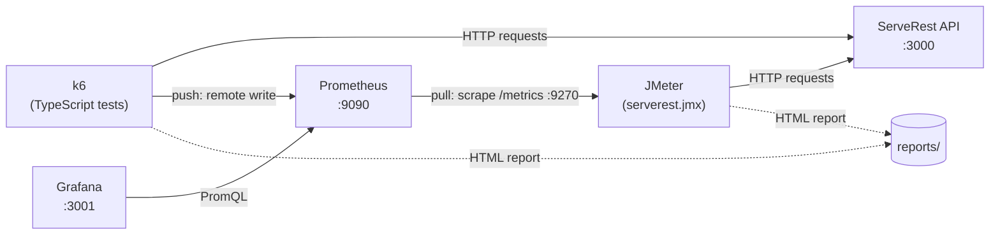

# Performance Testing

Performance tests against the [ServeRest](https://github.com/ServeRest/ServeRest) API, written with two tools:

- **[k6](https://grafana.com/docs/k6/latest/)**: tests as code, in **TypeScript**
- **[JMeter](https://jmeter.apache.org)**: a traditional `.jmx` test plan, editable in the JMeter GUI

Both run the same user journey and send their metrics to **Prometheus**, visualized in **Grafana**, everything running locally with Docker Compose.

## Architecture



| Component | Version | Role |
|---|---|---|
| [k6](https://grafana.com/docs/k6/latest/) | 2.3.0 | Load generator, runs the TypeScript tests natively |
| [JMeter](https://jmeter.apache.org) | 5.6.3 | Load generator, runs the `.jmx` test plan |
| [jmeter-prometheus-plugin](https://github.com/johrstrom/jmeter-prometheus-plugin) | 0.7.1 | Exposes the JMeter metrics on `:9270/metrics` |
| [ServeRest](https://serverest.dev) | 3.2.2 | REST API under test (users, login, products, carts) |
| [Prometheus](https://prometheus.io) | 3.15.1 | Stores the metrics of both tools |
| [Grafana](https://grafana.com) | 13.2.5 | Dashboards, provisioned automatically |

## Prerequisites

- [Docker](https://docs.docker.com/get-docker/) with Docker Compose
- [Node.js](https://nodejs.org) (optional): only for the npm scripts and type checking
- [JMeter](#running-jmeter-locally) (optional): only to open the test plan in the GUI

k6 and JMeter run inside containers, so neither needs to be installed to run the tests.

## Getting started

```bash
# 1. Install the dev dependencies (k6 types and TypeScript)
npm install

# 2. Start ServeRest, Prometheus and Grafana
npm run infra:up

# 3. Run a test with each tool
npm run k6:smoke
npm run jmeter:smoke

# 4. Stop everything when you are done
npm run infra:down
```

Then open Grafana at <http://localhost:3001>. The dashboards are organized in folders: **k6 › k6 Prometheus (Native Histograms)** (the home page) and **jmeter › JMeter Prometheus**. Select the run in the **testid** filter. No login is needed to view them (admin user: `admin` / `admin`).

| Service | URL |
|---|---|
| ServeRest (Swagger) | <http://localhost:3000> |
| Prometheus | <http://localhost:9090> |
| Grafana | <http://localhost:3001> |

## User journey

Every test runs the same journey, so the tests differ only in the tool and the load profile:

1. **sign up and login**: a new customer is created and logs in (JWT)
2. **browse products**: lists the catalog and opens a product
3. **checkout**: creates a cart and completes the purchase

The customer is deleted at the end of each iteration, and pauses of 1 to 3 seconds (think time) simulate a real user. Before the test an admin and a catalog of 20 products are created, and after it everything created by the test is removed.

| Step | k6 | JMeter |
|---|---|---|
| Before the test | `setup()` | `setUp Thread Group` |
| Journey | `default` function with `group()` | `Thread Group` with Simple Controllers |
| After the test | `teardown()` | `tearDown Thread Group` |
| Validations | `check()` | Response Assertions |

## k6

### Test types

| Test | Command | Load profile | Duration |
|---|---|---|---|
| Smoke | `npm run k6:smoke` | 1 VU | 1 min |
| Load | `npm run k6:load` | Ramp up to 20 VUs, hold for 5 min | ~8 min |
| Stress | `npm run k6:stress` | Steps of 20 → 50 → 100 → 150 VUs, 3 min each | ~15 min |
| Spike | `npm run k6:spike` | 5 VUs baseline, sudden spike to 200 VUs, recovery | ~4.5 min |
| Soak | `npm run k6:soak` | 20 VUs for 1 hour | ~1 h |

- **Smoke**: validates that the API and the scripts work before heavier tests.
- **Load**: expected day-to-day traffic.
- **Stress**: load beyond the expected traffic, to see how the API degrades.
- **Spike**: sudden burst of users and whether the API recovers afterwards.
- **Soak**: moderate load for a long time, to reveal memory leaks and gradual degradation.

### Thresholds

Thresholds are the pass/fail criteria: if any is exceeded, k6 exits with a non-zero code.

| Metric | Smoke, Load, Soak | Stress, Spike |
|---|---|---|
| `http_req_failed` | < 1% | < 5% |
| `http_req_duration` | p95 < 500 ms, p99 < 1 s | p95 < 1.5 s |
| `checks` | > 99% | > 95% |

### Configuration

The load can be changed with environment variables, without editing the scripts:

| Variable | Tests | Default | Description |
|---|---|---|---|
| `VUS` | load, soak | `20` | Virtual users at the target load |
| `DURATION` | load, soak | `5m` / `1h` | Time at the target load |
| `STEP_DURATION` | stress | `3m` | Time held at each step |
| `SPIKE_VUS` | spike | `200` | Virtual users at the peak |

```bash
VUS=50 DURATION=10m npm run k6:load
DURATION=10m npm run k6:soak
```

### Type checking

k6 runs TypeScript directly (no build step). `tsc` is used only to check types against `@types/k6`:

```bash
npm run typecheck
```

## JMeter

The test plan is [`jmeter/serverest.jmx`](jmeter/serverest.jmx). It is a regular JMeter test plan, built with the standard elements (HTTP Request, JSON Extractor, Response Assertion, timers) and Groovy (JSR223) only to generate data.

### Test types

| Test | Command | Load profile | Duration |
|---|---|---|---|
| Smoke | `npm run jmeter:smoke` | 1 thread | 1 min |
| Load | `npm run jmeter:load` | Ramp up to 20 threads in 2 min, then hold | 7 min |

The load is set by JMeter properties (`-J<name>=<value>`), read in the test plan with `${__P(name,default)}`:

| Property | Default | Description |
|---|---|---|
| `threads` | `20` | Number of threads (virtual users) |
| `rampup` | `120` | Seconds to start all the threads |
| `duration` | `420` | Test duration in seconds |
| `products` | `20` | Products created for the catalog |
| `host` / `port` / `protocol` | `localhost` / `3000` / `http` | ServeRest address |
| `testid` | `jmeter-local` | Test ID used in the Grafana filter |

There are no pass/fail thresholds as in k6: the [dashboard](#reports) highlights the same limits (error rate < 1%, p95 < 500 ms, p99 < 1 s).

### Running JMeter locally

To open and edit the test plan in the GUI, install JMeter (needs Java) and the Prometheus plugin. On macOS:

```bash
brew install jmeter

# Prometheus plugin: copy the jar to JMeter's lib/ext folder
curl -L -o "$(brew --prefix jmeter)/libexec/lib/ext/jmeter-prometheus-plugin-0.7.1.jar" \
  https://github.com/johrstrom/jmeter-prometheus-plugin/releases/download/0.7.1/jmeter-prometheus-plugin-0.7.1.jar
```

Then, with the stack running (`npm run infra:up`):

```bash
# Open the test plan in the GUI
npm run jmeter:gui

# Or run it in non-GUI mode (recommended for load tests)
jmeter -n -t jmeter/serverest.jmx -q jmeter/user.properties -Jthreads=5 -Jduration=120 -l results.jtl
```

The metrics of local runs are also sent to Grafana: Prometheus scrapes JMeter on the host through `host.docker.internal:9270` (testid `jmeter-local` by default). In the GUI, **View Results Tree (debug)** is disabled; enable it to inspect requests and responses while debugging.

### Running in Docker

The `jmeter` service builds an image with JMeter and the plugin ([`jmeter/Dockerfile`](jmeter/Dockerfile)) and runs the plan in non-GUI mode, the same as `npm run jmeter:*`:

```bash
docker compose run --rm --use-aliases jmeter -n -t serverest.jmx -q user.properties \
  -Jhost=serverest -Jtestid=my-run -Jthreads=10 -Jduration=300
```

`--use-aliases` registers the container as `jmeter` in the network, the address Prometheus scrapes.

## k6 vs JMeter

| | k6 | JMeter |
|---|---|---|
| Test definition | Code (TypeScript) | XML test plan, built in the GUI |
| Versioning and code review | Simple diffs | Verbose XML diffs |
| Virtual users | Goroutines, low memory per VU | Java threads, more memory per user |
| Metrics to Prometheus | **Push**: k6 sends them with remote write | **Pull**: Prometheus scrapes the plugin endpoint |
| Response time histogram | Native histogram (no fixed buckets) | Classic histogram (fixed `le` buckets) |
| Pass/fail criteria | Built-in thresholds | Assertions per request (no global thresholds) |
| Protocols | HTTP, WebSocket, gRPC, browser | HTTP, JDBC, JMS, FTP, LDAP and many others via plugins |
| Learning curve | Requires programming | Visual, accessible without programming |

Both are good choices: k6 fits teams that treat tests as code in CI, and JMeter fits teams that prefer a visual tool or need its wide protocol support.

## Reports

Besides Grafana, each run exports an HTML report to `reports/`, which can be opened in any browser without the stack running. The `testid` is generated automatically as `<tool>-<test>-<date-time>`, for example `k6-load-20261102-143000`.

| Tool | Report | Raw results |
|---|---|---|
| k6 | `reports/<testid>.html` (k6 web dashboard) | - |
| JMeter | `reports/<testid>/index.html` (JMeter dashboard) | `reports/<testid>.jtl` and `.log` |

## Running without npm

The npm scripts are shortcuts for Docker Compose commands:

```bash
docker compose up -d
docker compose run --rm k6 run --tag testid=my-run smoke.ts
docker compose run --rm -e VUS=50 k6 run --tag testid=my-load load.ts
docker compose run --rm --use-aliases jmeter -n -t serverest.jmx -q user.properties -Jhost=serverest -Jtestid=my-run
docker compose down
```

## Project structure

```
.
├── docker-compose.yml          # ServeRest, Prometheus, Grafana, k6 and JMeter services
├── prometheus/
│   └── prometheus.yml          # JMeter scrape job (k6 uses remote write)
├── grafana/
│   ├── dashboards/
│   │   ├── k6/                 # k6 dashboard (provisioned)
│   │   └── jmeter/             # JMeter dashboard (provisioned)
│   └── provisioning/           # datasource and dashboard providers
├── scripts/
│   ├── run-k6.sh               # runs a k6 test with a unique testid and HTML report
│   └── run-jmeter.sh           # runs the JMeter plan with a unique testid and HTML report
├── k6/
│   ├── lib/
│   │   ├── config.ts           # base URL and thresholds
│   │   ├── data.ts             # test data generators
│   │   ├── flows.ts            # user journey, setup and teardown
│   │   └── serverest.ts        # ServeRest API client with checks
│   ├── smoke.ts
│   ├── load.ts
│   ├── stress.ts
│   ├── spike.ts
│   └── soak.ts
└── jmeter/
    ├── Dockerfile              # JMeter + Prometheus plugin image
    ├── serverest.jmx           # test plan
    └── user.properties         # Prometheus plugin and results settings
```

## Troubleshooting

- **`failed to connect to the docker API`**: Docker is not running; start Docker Desktop.
- **Port already in use**: ports `3000`, `3001` and `9090` must be free; change the host side of the `ports` mappings in `docker-compose.yml` if needed. Local JMeter runs also use port `9270`.
- **`Could not create the admin session`** (k6) or **`setUp` errors** (JMeter): ServeRest is not reachable; check it with `docker compose ps`.
- **Empty dashboard**: select the run in the **testid** filter and adjust the time range to cover the test.
- **JMeter target down in Prometheus** (<http://localhost:9090/targets>): expected while no JMeter test is running. The `jmeter` (Docker) and `host.docker.internal` (local) targets are only up during a run.
- **Prometheus Listener missing in the JMeter GUI**: the plugin jar is not in `lib/ext`; see [Running JMeter locally](#running-jmeter-locally).
