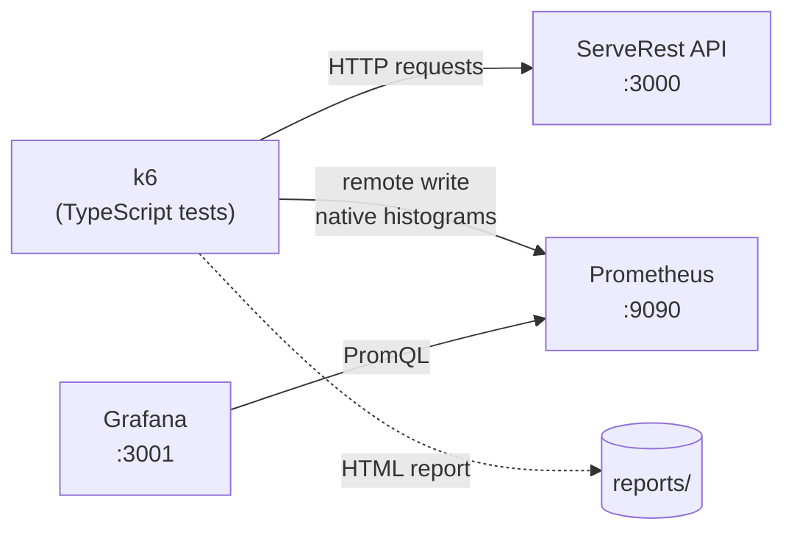

# k6 Performance Testing

Performance tests written in **TypeScript** with [k6](https://grafana.com/docs/k6/latest/), running against the [ServeRest](https://github.com/ServeRest/ServeRest) API. Metrics are sent to **Prometheus** and visualized in **Grafana**, everything running locally with Docker Compose.

## Architecture



| Component | Version | Role |
|---|---|---|
| [k6](https://grafana.com/docs/k6/latest/) | 2.3.0 | Load generator, runs the TypeScript tests natively |
| [ServeRest](https://serverest.dev) | 3.2.2 | REST API under test (users, login, products, carts) |
| [Prometheus](https://prometheus.io) | 3.15.1 | Stores the metrics pushed by k6 (remote write) |
| [Grafana](https://grafana.com) | 13.2.5 | Dashboards, provisioned automatically |

## Prerequisites

- [Docker](https://docs.docker.com/get-docker/) with Docker Compose
- [Node.js](https://nodejs.org) (optional): only for the npm scripts and type checking

k6 runs inside a container, so it does not need to be installed.

## Getting started

```bash
# 1. Install the dev dependencies (k6 types and TypeScript)
npm install

# 2. Start ServeRest, Prometheus and Grafana
npm run infra:up

# 3. Run a test
npm run test:smoke

# 4. Stop everything when you are done
npm run infra:down
```

Then open Grafana at <http://localhost:3001>. The **k6 Prometheus (Native Histograms)** dashboard is the home page; select the run in the **testid** filter. No login is needed to view it (admin user: `admin` / `admin`).

| Service | URL |
|---|---|
| ServeRest (Swagger) | <http://localhost:3000> |
| Prometheus | <http://localhost:9090> |
| Grafana | <http://localhost:3001> |

## User journey

Every test runs the same journey, so the test types differ only in the load profile:

1. **sign up and login**: a new customer is created and logs in (JWT)
2. **browse products**: lists the catalog and opens a product
3. **checkout**: creates a cart and completes the purchase

The customer is deleted at the end of each iteration, and pauses of 1 to 3 seconds (think time) simulate a real user. `setup()` creates an admin and the product catalog, and `teardown()` removes everything created by the test.

## Test types

| Test | Command | Load profile | Duration |
|---|---|---|---|
| Smoke | `npm run test:smoke` | 1 VU | 1 min |
| Load | `npm run test:load` | Ramp up to 20 VUs, hold for 5 min | ~8 min |
| Stress | `npm run test:stress` | Steps of 20 → 50 → 100 → 150 VUs, 3 min each | ~15 min |
| Spike | `npm run test:spike` | 5 VUs baseline, sudden spike to 200 VUs, recovery | ~4.5 min |
| Soak | `npm run test:soak` | 20 VUs for 1 hour | ~1 h |

- **Smoke**: validates that the API and the scripts work before heavier tests.
- **Load**: expected day-to-day traffic.
- **Stress**: load beyond the expected traffic, to see how the API degrades.
- **Spike**: sudden burst of users and whether the API recovers afterwards.
- **Soak**: moderate load for a long time, to reveal memory leaks and gradual degradation.

### Thresholds

Thresholds are the pass/fail criteria: if any is exceeded, k6 exits with a non-zero code.

| Metric | Smoke, Load, Soak | Stress, Spike |
|---|---|---|
| `http_req_failed` | < 1% | < 5% |
| `http_req_duration` | p95 < 500 ms, p99 < 1 s | p95 < 1.5 s |
| `checks` | > 99% | > 95% |

### Configuration

The load can be changed with environment variables, without editing the scripts:

| Variable | Tests | Default | Description |
|---|---|---|---|
| `VUS` | load, soak | `20` | Virtual users at the target load |
| `DURATION` | load, soak | `5m` / `1h` | Time at the target load |
| `STEP_DURATION` | stress | `3m` | Time held at each step |
| `SPIKE_VUS` | spike | `200` | Virtual users at the peak |

```bash
VUS=50 DURATION=10m npm run test:load
DURATION=10m npm run test:soak
```

> ServeRest is lightweight and handles these default loads easily. To push it harder, increase the variables above. Keep in mind that k6 and the API share the same machine, so the limits found also reflect your computer's resources.

## Reports

Besides Grafana, each run exports an HTML report (k6 web dashboard) to `reports/<testid>.html`, which can be opened in any browser without the stack running. The `testid` is generated automatically as `<test>-<date-time>`, for example `load-20261102-143000`.

## Running without npm

The npm scripts are shortcuts for Docker Compose commands:

```bash
docker compose up -d
docker compose run --rm k6 run --tag testid=my-run smoke.ts
docker compose run --rm -e VUS=50 k6 run --tag testid=my-load load.ts
docker compose down
```

## Project structure

```
.
├── docker-compose.yml          # ServeRest, Prometheus, Grafana and k6 services
├── prometheus/
│   └── prometheus.yml
├── grafana/
│   ├── dashboards/             # k6 dashboard (provisioned)
│   └── provisioning/           # datasource and dashboard providers
├── scripts/
│   └── run-test.sh             # runs a test with a unique testid and HTML report
└── tests/
    ├── lib/
    │   ├── config.ts           # base URL and thresholds
    │   ├── data.ts             # test data generators
    │   ├── flows.ts            # user journey, setup and teardown
    │   └── serverest.ts        # ServeRest API client with checks
    ├── smoke.ts
    ├── load.ts
    ├── stress.ts
    ├── spike.ts
    └── soak.ts
```

## Type checking

k6 runs TypeScript directly (no build step). `tsc` is used only to check types against `@types/k6`:

```bash
npm run typecheck
```

## Troubleshooting

- **`failed to connect to the docker API`**: Docker is not running; start Docker Desktop.
- **Port already in use**: ports `3000`, `3001` and `9090` must be free; change the host side of the `ports` mappings in `docker-compose.yml` if needed.
- **`Could not create the admin session`**: ServeRest is not reachable; check it with `docker compose ps`.
- **Empty dashboard**: select the run in the **testid** filter and adjust the time range to cover the test.
